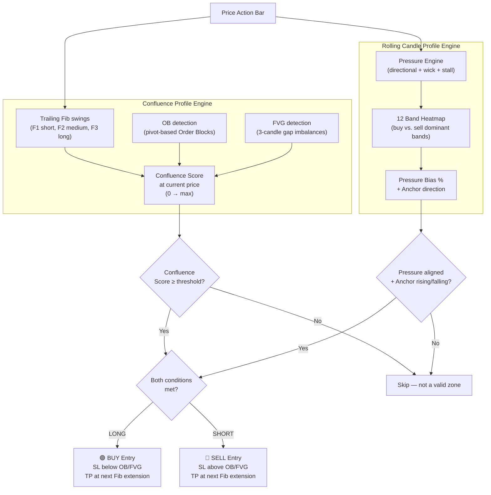

# Combined Strategy: Confluence Profile × Rolling Candle Profile

---

## Why These Two Are a Perfect Match

Each indicator solves **a different half** of the trading problem:

| | Confluence Profile | Rolling Candle Profile |
|---|---|---|
| **Role** | **WHERE** to trade | **WHEN** to trade |
| **Looks at** | Historical structure (Fib, OB, FVG, Volume nodes) | Real-time pressure momentum |
| **Gives you** | A scored map of support/resistance zones | A live directional bias signal |
| **Weakness alone** | Tells you the zone but not whether now is the right moment | Can fire at any price — including no-man's land |
| **Fixed by combining** | Only trade the high-confluence zones | Only enter when pressure confirms direction |

> [!IMPORTANT]
> Confluence Profile answers: *"Is this a structurally significant price area?"*
> Rolling Candle Profile answers: *"Is momentum aligned with a trade in this direction right now?"*
> Together: *"Is this a high-probability entry at a valid structural zone with momentum confirmation?"*

---

## Strategy Architecture



---

## Combined Signal Rules

### LONG (BUY) — All conditions required:

| # | Condition | Source |
|---|-----------|--------|
| 1 | Price is within `tolerance` of a Fib retracement level (38.2%, 50%, 61.8%) | Confluence Profile |
| 2 | A bullish OB or bullish FVG exists near current price | Confluence Profile |
| 3 | Confluence Score ≥ 2 at current price (Fib + OB/FVG stacking) | Confluence Profile |
| 4 | Rolling pressure `buyBands > sellBands` with ≥ 7 colored bands | Rolling Profile |
| 5 | Pressure bias `profBias ≥ 0.25` (25% net buy dominance) | Rolling Profile |
| 6 | `close > anchor` AND `anchor` is rising | Rolling Profile |
| 7 | At least `sigGap` bars since last BUY | Both |

### SHORT (SELL) — Mirror of above:
1. Fib resistance level nearby
2. Bearish OB or FVG nearby
3. Confluence Score ≥ 2
4. `sellBands > buyBands` with ≥ 7 visible bands
5. `profBias ≤ -0.25`
6. `close < anchor` AND anchor falling
7. Minimum bar gap respected

### Exit Logic

| Exit Type | Rule |
|-----------|------|
| **Stop Loss** | Below the bottom of the nearest bullish OB or FVG (for longs) |
| **Take Profit 1** | At the next Fib extension (1.272 of the triggering swing) |
| **Take Profit 2** | At the swing high/low (level 0 or 1 of the swing) |
| **Trailing Exit** | When pressure flips: `profBias` crosses zero or anchor reverses direction |

---

## Why This Combination is Stronger Than Either Alone

### Problem 1 — Rolling Profile fires in no-man's land
Without the confluence filter, Rolling Profile can fire BUY signals in the middle of a range with nothing structural to support the trade. Adding the Confluence filter ensures signals only fire at **Fib + OB/FVG stacked zones**, where large institutions are likely resting orders.

### Problem 2 — Confluence Profile is static
Confluence Profile shows *where* to watch but gives no entry timing. You can be watching the right zone but enter 20 bars too early (before momentum arrives) or too late (after the move). Rolling Profile's pressure engine provides **real-time confirmation** that buyers/sellers are actually stepping in at that exact level.

### Problem 3 — False breakouts
Rolling Profile can fire signals on breakouts that immediately reverse. If the breakout direction is *away* from a high-confluence zone, that's a warning. If the breakout is *into* a confluence zone (price retesting it), that's a high-probability setup.

---

## Signal Quality Scoring (Optional Enhancement)

You can assign a quality tier to each signal based on how many layers stack:

| Score | Grade | Conditions |
|-------|-------|-----------|
| 2 | ⭐ Basic | Fib level + Rolling pressure aligned |
| 3 | ⭐⭐ Good | + OB or FVG nearby |
| 4 | ⭐⭐⭐ Strong | + Volume node (HVN) at same level |
| 5+ | ⭐⭐⭐⭐ Optimal | All factors stacked (Fib + OB + FVG + HVN + pressure) |

Only trade ⭐⭐⭐ and above for maximum reliability.

---

## Implementation Plan (Pine Script)

> [!NOTE]
> Both indicators can be merged into a single `strategy()` script. The key restructuring needed:
> - Confluence Profile computes only on `barstate.islast` (for display). For the strategy, the **Fib levels, OB, and FVG arrays already update bar-by-bar** — they just need to be queried at each bar.
> - Rolling Profile already works bar-by-bar — it can be ported directly.

### Core Modules to Merge:

```
Module 1: Trailing Fib swings (from Confluence) → bar-by-bar Fib level detection
Module 2: OB tracking array (from Confluence) → updates on each confirmed bar
Module 3: FVG tracking array (from Confluence) → updates on each confirmed bar
Module 4: Confluence score at close (from Confluence) → calculated each bar
Module 5: Pressure engine + anchor (from Rolling) → already bar-by-bar
Module 6: Combined entry condition → new logic
Module 7: strategy.entry() / strategy.exit() → stop loss from OB/FVG, TP from Fib extension
```

### Estimated Size: ~500–650 lines of Pine Script

---

## Risks / Limitations

> [!WARNING]
> - **Repaint risk**: "Live" (unconfirmed) rolling signals can disappear before bar close. Use only `barstate.isconfirmed` signals in the strategy.
> - **Swing lag**: Fib swings are confirmed `len` candles after the actual pivot — entries may lag slightly.
> - **Over-confluence**: Too many filters can cause missed trades. Start with Confluence Score ≥ 2 and loosen if needed.
> - **No volume on some symbols**: Confluence volume profiles and Volume Delta mode won't work on markets without volume data (some forex pairs, indices). Use Price Pressure mode.

---

## Recommended Settings for Combined Strategy

| Parameter | Suggested Value | Reason |
|-----------|----------------|--------|
| Confluence Score threshold | ≥ 2 | Requires at minimum Fib + 1 zone |
| Fib levels to watch | 38.2%, 50%, 61.8% | The golden retracements |
| Anchor type | EMA 21 | Responsive but not too noisy |
| Pressure mode | Hybrid | Best of price + volume |
| Min colored bands | 7 / 12 | Same as default |
| Pressure dominance | 0.25 | Same as default |
| Signal spacing | 6 bars | Avoid spam on retracements |
| TP ratio | 1:1.5 to 1:2 R:R | Fib extensions typically give this |
