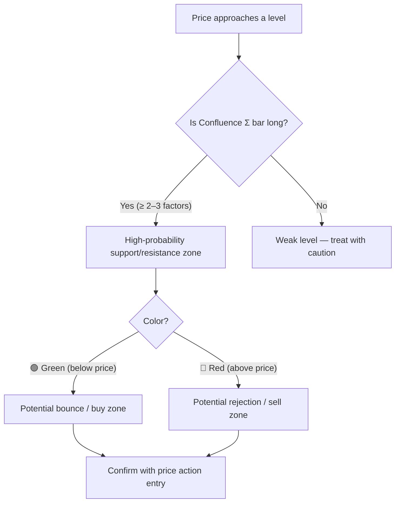

# Confluence Profile — Indicator Explained

> [!NOTE]
> Author: `Uncle_the_shooter` · Pine Script v6 · overlay indicator
> File: `indicator/confluence profile.pine`

---

## What It Does

**Confluence Profile** is a visual framework that answers one question:

> *At which price levels do multiple independent technical factors stack up at the same time?*

It draws a **side panel** to the right of the candles (like a volume profile) with up to **9 narrow columns** + 1 wide **Confluence (Σ) bar chart**. Each column shows one factor; the final bar chart shows their weighted sum per price row — the **higher the bar, the more "confluence"** at that price.

---

## The 5 Types of Factors

### 1. Fibonacci Levels (columns F1 / F2 / F3)
- Uses **three trailing swing sizes**: short (default pivot 10), medium (30), long (80).
- Each swing is **auto-detected** via confirmed pivot highs/lows. It always measures the **most recent up/down leg** — no manual redrawing needed.
- **Level 0** = more recent extreme, **Level 1** = older extreme. Retracements and extensions in between are configurable (0.236, 0.382, 0.5, 0.618, 0.786, 1.272…).
- Swing endpoints marked on the chart with dashed lines and labels (e.g., `F1: 0`, `F1: 1`).

### 2. Order Blocks (column OB)
- Identified at confirmed pivot highs/lows using a separate `pivot_length` (default 12).
- **Bullish OB** = last bearish candle before an up-move; **Bearish OB** = last bullish candle before a down-move.
- Oversized OBs (> 2× ATR) are trimmed to the pivot candle's wick only.
- An OB is **removed** when price closes beyond it.

### 3. Fair Value Gaps (column FVG)
- A **bullish FVG**: `low[0] > high[2]` (gap up — price skipped a range).
- A **bearish FVG**: `high[0] < low[2]` (gap down).
- Only gaps ≥ `fvg_min_atr × ATR` (default 0.25×) are kept.
- Three fill modes: **Shrink** (gap edge moves as price fills it), **Remove at 50%** (CE cross removes it), **None**.

### 4. Volume Profiles (columns V1 / V2 / V3)
- Each Fib swing has its own volume profile covering **the bars from the swing's anchor to the most recent closed candle**, within the swing's price range.
- Mode **"Nodes"** (default): only shows **High Volume Nodes** — areas with volume above the local average — which are the most meaningful.
- Mode **"Total volume"**: raw histogram.

### 5. Extended-History Volume (column Vext)
- Only active when you enable Fib levels **beyond the swing** (< 0 or > 1 extensions).
- Covers bars back to the **last time price touched the outermost Fib level**, giving a volume picture of an older market structure zone.
- Skipped (shows `=V3`) if its bar range overlaps ≥ 80% with an existing profile.

---

## The Confluence (Σ) Column

This is the **key output**. For every price row, the indicator sums up:

```
Σ = (F1 hit × wF1) + (F2 hit × wF2) + (F3 hit × wF3)
  + (OB present × wOB)
  + (FVG present × wFVG)
  + (V1 node × wV1) + (V2 node × wV2) + (V3 node × wV3) + (Vext node × wVz)
```

- Fib / OB / FVG = binary (0 or 1).
- Volume = fractional (0–1) based on node strength.
- All weights default to 1.0, but can be tuned (e.g., 0.5 for volumes to avoid double-counting since V1–V3 overlap).
- **Green bars** = below current price → **support zones**.
- **Red bars** = above current price → **resistance zones**.
- Longer bar = more factors aligned = stronger zone.

A **live label** at the right edge shows the exact score at the current price, e.g.:  
`Confluence 3.5: F2 OB↑ V2`

---

## Visual Layout

```
[Candles] ← mxOffset → [Σ][F1][F2][F3][OB][FVG][V1][V2][V3][Vext]
                         ^                                         ^
                    (mirror=true: Σ is closest to candles)
```

| Column | Content | Color |
|--------|---------|-------|
| **F1/F2/F3** | Fib level lines (red = level, text color = endpoint) | Hot red |
| **OB** | Order block zones (exact edges) | 🟢 Bullish / 🔴 Bearish |
| **FVG** | Fair value gap zones (exact edges) | 🟢 Bullish / 🔴 Bearish |
| **V1/V2/V3/Vext** | Volume node intensity (cold→mid→hot gradient) | Blue → Orange → Red |
| **Σ** | Weighted confluence bar chart | 🟢 below price / 🔴 above price |

---

## Key Settings Summary

| Setting | Default | Purpose |
|---------|---------|---------|
| ATR Length | 100 | Baseline candle size for all ATR-relative settings |
| Tolerance (ATR) | 0.15 | How close two factors must be to "count" as the same price area |
| Short / Medium / Long pivot | 10 / 30 / 80 | Swing detection sensitivity for F1/F2/F3 |
| Include Ends (0% & 100%) | On | Swing highs/lows themselves count as Fib levels |
| OB Pivot Length | 12 | Candles on each side for OB detection |
| FVG Min Height | 0.25 ATR | Minimum gap size to include |
| Volume Mode | Nodes | Nodes (HVN) vs. raw total volume |
| Confluence Weights | 1.0 each | Per-component weight in the Σ sum |
| Column Width / Offset | 4 / 4 candles | Panel position and size |
| Mirror Layout | On | Σ column appears closest to candles |
| Show Zones on Chart | None | Optionally overlay OBs/FVGs on the candle area |

---

## How to Use It for Trading



**Practical example:**  
If the Σ bar at a price shows `F2 + OB↑ + V2` = score 3.0 and the bar is green (below price), that level is supported by:
- A medium Fib retracement
- A bullish Order Block
- A High Volume Node from the medium swing

→ Strong support → look for a bullish entry trigger there.

---

> [!TIP]
> Lower volume weights (e.g., 0.5 for V1/V2/V3) to reduce double-counting, since shorter swings are nested inside longer ones and their volume profiles overlap significantly.

> [!IMPORTANT]
> The indicator **recalculates only on the last bar** (all profile drawing is deferred to `barstate.islast`). This keeps it performant but means the panel only updates after each new bar closes.
