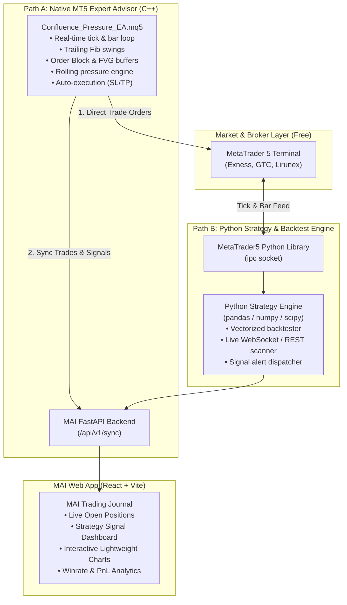
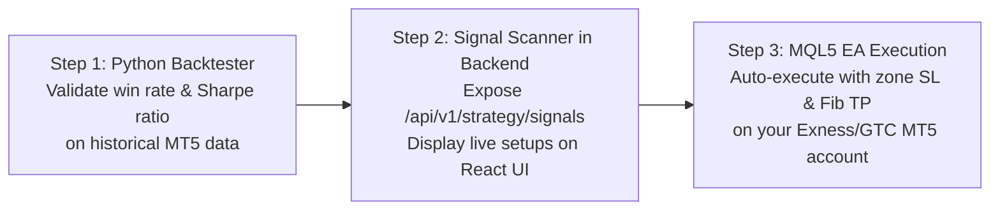

# Blueprint: Executing Confluence Pressure Strategy Outside TradingView (100% Free)

---

## Executive Summary

TradingView imposes strict limits on free accounts: **0.5-second execution timeout, 64-plot cap, limited historical bars (5,000 bars), and webhook alert restrictions**.

By moving the execution into your existing **MAI-Trading ecosystem**, you unlock:
- **Zero compute time limits** (runs in native C++ or high-speed Python/NumPy)
- **Unlimited historical bars** (test across 10+ years of tick-by-tick data)
- **Automated trade execution** directly on your broker via MetaTrader 5
- **Zero monthly subscriptions** (100% free forever)
- **Full integration** with your existing MAI Trading Journal web dashboard

---

## Architectural Architecture



---

## Path A: Native MetaTrader 5 Expert Advisor (MQL5)

This path runs directly inside your MT5 terminal on your computer or VPS. It executes orders automatically with microsecond latency.

### 1. Key Advantages
- **Instant Execution**: No network latency between signal and order entry.
- **Zero Server Costs**: Runs inside the MT5 terminal you already have open.
- **Microsecond Speed**: Native compiled C++ execution.

### 2. MQL5 Architecture Breakdown

| Module in MQL5 | Pine Script Equivalent | Implementation in MQL5 |
|---|---|---|
| **Anchor Engine** | `anchor = ta.ema(close, 21)` | `iMA(Symbol(), Period(), 21, 0, MODE_EMA, PRICE_CLOSE)` |
| **Intrabar Pressure** | `buyPart`, `sellPart`, `wickW` | Read M1 bars inside the current H1/M15 candle via `CopyRates()` |
| **Trailing Fib Swings** | `trailFib(len)` | Custom ZigZag swing buffer tracking pivot highs/lows |
| **Order Block Engine** | `obZones` array | Dynamic struct array `struct OrderBlock { double top, bot; datetime time; bool isBull; }` |
| **FVG Engine** | `fvgZones` array | Scan 3-candle gaps on new bar open: `Low[0] > High[2]` or `High[0] < Low[2]` |
| **Trade Manager** | `strategy.entry` / `strategy.exit` | `CTrade` class: `trade.Buy()`, `trade.Sell()` with zone-based SL and Fib-based TP |

### 3. Execution Flow
1. **OnTick()**:
   - Updates trailing anchor value and checks trailing stop (anchor cross exit).
2. **OnBar()** (New closed candle):
   - Scans for new pivot high/low → updates trailing Fib swing.
   - Detects newly formed Order Blocks and FVGs.
   - Computes rolling buying/selling pressure balance over the last 14 bars.
   - Checks if `Confluence Score >= 2` + `Pressure Bias >= 25%` + `Anchor direction aligned`.
   - If conditions match → opens market order with SL below OB/FVG and TP at 1.272 Fib extension.
   - Posts signal & trade execution metadata to your MAI Journal `/api/v1/sync`.

---

## Path B: Python Engine & Web Dashboard Integration

This path runs in your Python backend and displays real-time signals, charts, and backtest results inside your **MAI Trading Journal React UI**.

### 1. Key Advantages
- **Beautiful Web Interface**: View the strategy signals, charts, and heatmap on your phone, tablet, or web browser without looking at MT5.
- **Deep Backtesting**: Backtest 5 years of historical data in 3 seconds using NumPy vectorized operations.
- **Multi-Symbol Scanning**: Scan 30 forex pairs and gold (XAUUSD) simultaneously for confluence setups.

### 2. Python Architecture Breakdown

```
backend/
├── strategy/
│   ├── __init__.py
│   ├── confluence_engine.py    # Fib swings, OB detection, FVG detection
│   ├── pressure_engine.py      # Price & volume directional momentum
│   ├── combined_strategy.py    # Entry/Exit rule validation & signals
│   └── backtester.py           # Vectorized backtest & metric calculator (Sharpe, DD)
├── routers/
│   └── strategy.py             # API endpoints: /signals, /backtest, /scan
```

### 3. Core Algorithm Translation (Pine Script → Python NumPy)

```python
import numpy as np
import pandas as pd

def calculate_pressure(df: pd.DataFrame, wick_weight=0.85):
    """Vectorized calculation of buying and selling pressure."""
    r = np.maximum(df['high'] - df['low'], 1e-5)
    directional = np.clip((df['close'] - df['open']) / r, -1.0, 1.0)
    travel = np.clip((df['close'] - df['close'].shift(1)) / r, -1.5, 1.5)
    close_loc = np.clip((2.0 * df['close'] - df['high'] - df['low']) / r, -1.0, 1.0)
    
    response = np.clip(0.55 * travel + 0.25 * directional + 0.20 * close_loc, -1.5, 1.5)
    force = np.abs(response)
    
    low_wick = np.maximum(0.0, np.minimum(df['open'], df['close']) - df['low']) / r
    high_wick = np.maximum(0.0, df['high'] - np.maximum(df['open'], df['close'])) / r
    
    buy_part = np.maximum(response, 0.0) * (1.0 + force * 1.25) * 2.0
    sell_part = np.maximum(-response, 0.0) * (1.0 + force * 1.25) * 2.0
    
    total_buy = buy_part + wick_weight * low_wick
    total_sell = sell_part + wick_weight * high_wick
    
    # 14-period EMA rolling pressure
    roll_buy = total_buy.ewm(span=14).mean()
    roll_sell = total_sell.ewm(span=14).mean()
    roll_total = roll_buy + roll_sell
    
    pressure_bias = np.where(roll_total > 0, (roll_buy - roll_sell) / roll_total, 0.0)
    return pressure_bias
```

---

## Comparison Matrix: TradingView vs. Free Independent Solutions

| Feature | TradingView Free | Path A: MT5 Expert Advisor | Path B: Python + MAI Web |
|---|:---:|:---:|:---:|
| **Monthly Cost** | Free ($0) | **Free ($0)** | **Free ($0)** |
| **Execution Time Limit** | ⚠️ Strict 0.5s timeout | **None (0 µs lag)** | **None (Unlimited)** |
| **Max Plots Limit** | ⚠️ Hard cap at 64 plots | **Unlimited** | **Unlimited (WebGL / Canvas)** |
| **Historical Bars** | ⚠️ Only 5,000 bars | **Entire broker history (100k+)** | **Unlimited (CSV / DB)** |
| **Automated Trading** | ❌ Requires paid Webhook + bridge | **✅ Native automatic execution** | **✅ Via MT5 Python API** |
| **Multi-Chart Scanning** | ❌ 1 chart at a time | **✅ Multi-currency EA** | **✅ Scans all pairs simultaneously** |
| **Mobile Dashboard** | TV App (requires subscription for alerts) | MT5 Mobile notifications | **Your MAI Trading App on mobile** |

---

## Recommended Step-by-Step Implementation Roadmap



1. **Step 1 (Offline Validation)**:
   - Run the Python engine against your 616 past trades in Neon DB to verify how many setups were flagged.
2. **Step 2 (Live Web Scanner)**:
   - Add a "Live Signals" tab to your MAI Trading Journal dashboard showing current confluence scores (`Σ 2.5✦✦✦`) for XAUUSD and EURUSD.
3. **Step 3 (Automated Execution)**:
   - Compile the standalone MQL5 Expert Advisor so trades execute automatically 24/5 on your desktop or a cheap $3/mo Forex VPS.
