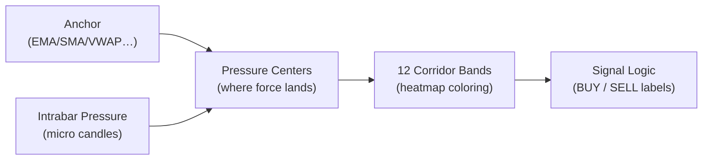
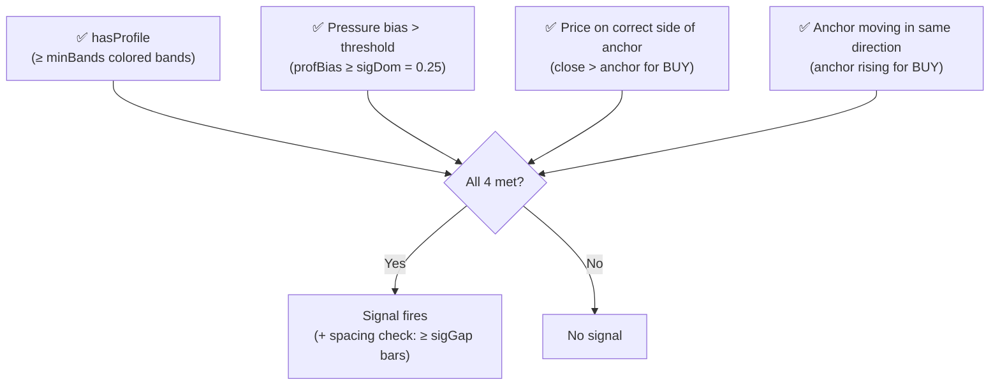

# Rolling Candle Profile with Buy/Sell Signals — Explained

> [!NOTE]
> Author: `Zeiierman` · Pine Script v6 · Overlay indicator, rendered behind chart
> File: `indicator/rolling candle profile with buy sell signals.pine`

---

## What It Does (One Paragraph)

This indicator builds a **live, rolling "pressure heatmap"** between the current candle and a moving anchor (EMA/SMA/VWAP etc.). It measures which price levels inside that corridor are dominated by **buying pressure** (green) or **selling pressure** (red), then plots 12 colored gradient bands to show where the market is most active. When all conditions align — the right pressure bias, the right number of colored bands, and price on the correct side of a rising/falling anchor — it fires a **BUY** or **SELL** signal label.

---

## Architecture: 4 Stages



---

## Stage 1: The Anchor

The **anchor** is a smoothed price reference line. It acts as the spine of the heatmap corridor.

| Option | Behavior |
|--------|----------|
| `EMA` (default, len 21) | Responsive exponential average |
| `SMA` | Simple average |
| `VWMA` | Volume-weighted average |
| `VWAP` | Session VWAP (resets daily) |
| `Donchian Mid` | Midpoint of highest-high / lowest-low |

- If anchor is **rising** → tinted **green (buy color)**
- If anchor is **falling** → tinted **red (sell color)**

The corridor always runs from the **anchor to the nearest candle body edge** (never inside the body — it starts at `bodyLo` or `bodyHi` depending on which side the anchor is on).

---

## Stage 2: The Pressure Engine

This is the core calculation. For each bar, the engine decomposes the candle into several sub-signals:

### Intrabar Mode (Optional)
If you configure a **lower timeframe** (e.g., 1-minute bars while on a 5-minute chart), the engine processes each sub-candle individually (up to 90 micro-bars per chart bar). This gives far more precise pressure readings.

### What Gets Measured Per Bar

```
Directional  = (close - open) / range       → −1 (full sell) to +1 (full buy)
Travel       = (close - prevClose) / range   → momentum vs prior bar
CloseLoc     = (2×close - high - low) / range → where close is in the bar
Response     = 0.55×travel + 0.25×directional + 0.20×closeLoc
Force        = |Response|                    → strength of movement
Continuation = 1.45 if same direction as prev bar, 0.55 if reversal
```

### Three Pressure Modes

| Mode | How BuyPart is Calculated |
|------|--------------------------|
| **Price Pressure** | `max(Response,0) × (1 + Force×1.25) × Continuation × 2` — pure price action |
| **Volume Delta** | `Volume × (1 + Directional) / 2` — raw buy/sell volume split |
| **Hybrid** | Mix of both: volume scaled by force, direction from blend of response |

### Wick Rejection
Lower wicks → **buy rejection** (price tested low but bounced up)
Upper wicks → **sell rejection** (price tested high but fell back)
These are added to buy/sell pressure fields with a configurable `Wick rejection influence` weight.

### Stall Pressure
When `Force` is low (sideways/indecisive bars), a **stall** component accumulates — this increases friction in the band coloring.

### Pressure Centers (Where Forces Land)
Each pressure component has a **price center** (a weighted average price), so the kernel can place it accurately in the band grid:
- Buy pressure → near close + slight pull toward the high
- Sell pressure → near close + slight pull toward the low
- Wick rejections → at the wick midpoints

---

## Stage 3: The 12 Corridor Bands (The Heatmap)

The corridor from anchor to candle body edge is split into **12 equal bands**.

For each band, the engine looks back **60 bars** using a **Gaussian-like kernel** (`smooth-step` function):

```
kernel(here, center, invWidth) = (1 - |here - center| × invWidth)²  × (3 - 2×(1 - …))
```

This means: *"how much of the pressure from this past bar falls at this exact price level?"*

The 60 historical bars are **age-decayed** (`0.5^(1/3)` per bar) so recent pressure matters far more than old pressure.

### For each band, the final values are:

| Metric | What it means |
|--------|---------------|
| `imbalance` | `(buyField - sellField) / total`, clamped −1 to +1 |
| `activity` | Total pressure vs. the recent baseline — how "hot" this zone is |
| `stalledRatio` | Ratio of stall pressure to total — how congested |

### Band Coloring Rules

- `imbalance > 0.03` → **green** (buying dominant)
- `imbalance < −0.03` → **red** (selling dominant)
- `activity < 0.08` → **gray** (not enough activity — fade to transparent)
- The **alpha (transparency)** is inversely proportional to activity and imbalance strength
- Low activity or low imbalance → `na` (invisible)

> [!TIP]
> The **Brightness** setting shifts the alpha calculation, making bands more visible without changing their underlying pressure data.

---

## Stage 4: BUY / SELL Signals

The signal logic requires **all 4 conditions** to be true simultaneously:



### BUY Signal conditions:
1. `visBands >= minBands` (default 7 of 12 bands must be colored)
2. `profBias >= sigDom` (default 0.25 = 25% net buying dominance)
3. `close > anchor` (price above anchor)
4. `anchor` is rising (`anchor > anchor[1]`)
5. At least `sigGap` (default 6) bars since last BUY

### SELL Signal conditions (mirror image):
1. `visBands >= minBands`
2. `profBias <= -sigDom` (net selling dominance)
3. `close < anchor` (price below anchor)
4. `anchor` is falling
5. At least `sigGap` bars since last SELL

> [!IMPORTANT]
> Signals that fire **before the bar closes** are labeled "Live (not confirmed — can disappear before close)". Only confirmed signals (on closed bars) are reliable for backtesting.

### Label Placement
Labels appear at the **recent high or low** (looking back `labLookback` = 10 bars), not at an arbitrary price — this prevents floating labels far from the candle. A `Max label distance (ATR)` cap prevents labels from drifting too far if the extreme happened many bars ago.

---

## Visual Summary on Chart

```
  High ─────────────────────────────
         SELL ▼                        (label below recent high)
  
  [Band 12] ████ RED    ←── anchor end (body edge)
  [Band 11] ███  RED
  [Band 10] ██   red
  [Band 9 ] ░    gray (low activity)
  [Band 8 ] ░
  [Band 7 ] ░
  [Band 6 ] ░
  [Band 5 ] ██   green
  [Band 4 ] ███  GREEN
  [Band 3 ] ████ GREEN  ←── anchor start
  
  ════════════════  Anchor line (green if rising / red if falling)
  
  Low ──────────────────────────────
         BUY ▲                         (label above recent low)
```

---

## Key Settings at a Glance

| Setting | Default | Effect |
|---------|---------|--------|
| Anchor type | EMA 21 | Reference center of the corridor |
| Pressure input | Price Pressure | No volume needed; use Hybrid for stronger signals with volume |
| Intrabar TF | Manual (blank = chart TF) | Set to lower TF for more granular pressure |
| Price-localization width | 0.01 | Lower = sharper pressure pockets, higher = smoother |
| Wick rejection influence | 0.85 | How much wick rejections contribute to pressure |
| Brightness | 3.0 | Band visibility (max) |
| Pressure dominance threshold | 0.25 | Min 25% net bias needed for a signal |
| Minimum colored bands | 7/12 | Prevents signals during low-activity zones |
| Minimum signal spacing | 6 bars | Anti-spam gap between same-direction signals |

---

## How to Use It for Trading

> [!TIP]
> This indicator works best on trending markets. In choppy sideways conditions, the anchor oscillates and signals become frequent noise.

**Checklist for a high-quality BUY:**
- [ ] Anchor is clearly green and sloping up
- [ ] Multiple green bands visible (7+/12)
- [ ] Price has pulled back to or just above the anchor
- [ ] BUY label appears on a **confirmed** (closed) bar
- [ ] Confirm with higher timeframe bias

**What to avoid:**
- Signals in ranging conditions (anchor flat, bands mostly gray)
- "Live" signals that haven't confirmed yet
- Very narrow corridors (anchor too close to price)
